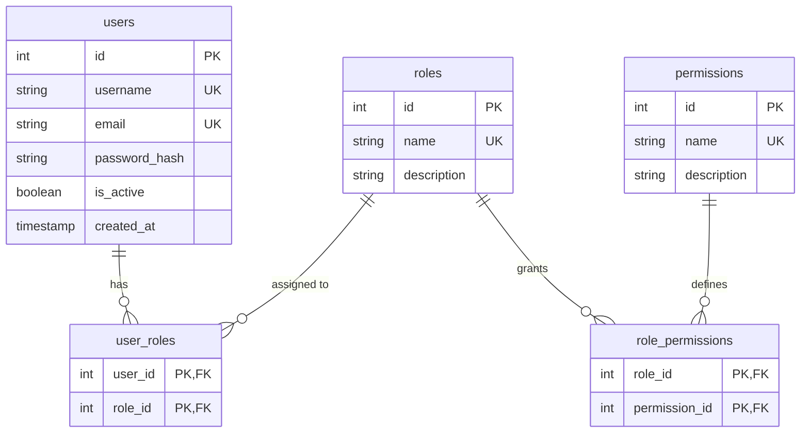

# Academic Defense Presentation & Architectural Justification Guide
## Web Quiz Assessment Engine (Python Flask + MySQL OOP)

---

## 1. Executive Summary & Project Abstract

The **Web Quiz Assessment Engine** is an enterprise-grade academic assessment platform built with **Python (Flask)** and **MySQL**, adhering strictly to **Object-Oriented Programming (OOP)**, **Layered Architecture**, and a **Decoupled 5-Table Role-Based Access Control (RBAC)** standard.

The platform provides a **Google Forms-inspired user experience** (signature `#673ab7` purple styling, floating card containers, visual question builder with inline radio answer-key selection, and responses analytics) while enforcing strict multi-tenant authorization boundaries across three user personas:
- **Admin**: Master administrative control over user accounts, role assignments, active statuses, and quizzes.
- **Teacher**: Visual authoring of timed assessments, question banks, response inspection, score adjustments with qualitative feedback, and CSV data export.
- **Student**: Account self-registration, timed assessment execution with live countdown and auto-submission, and historical score review.

---

## 2. Decoupled Layered Architecture & SOLID Analysis

The application strictly separates concerns across four distinct architectural tiers:

```
┌─────────────────────────────────────────────────────────────┐
│                    Web & Security Layer                     │
│   (Flask Blueprints, @login_required, @require_permission)   │
└──────────────────────────────┬──────────────────────────────┘
                               │ Orchestrates requests
                               ▼
┌─────────────────────────────────────────────────────────────┐
│                    Business Logic Layer                     │
│    (AuthService, QuizService, GradingService - Rules & Logic)│
└──────────────────────────────┬──────────────────────────────┘
                               │ Enforces invariants & persists
                               ▼
┌──────────────────────────────┬──────────────────────────────┐
│         Domain Layer         │      Data Access Layer       │
│  (Pure Dataclass Entities:   │ (Repositories, Raw SQL %s,   │
│   User, Quiz, Question,      │  Explicit ACID Transactions) │
│   Submission, Option)        │                              │
└──────────────────────────────┴──────────────────────────────┘
                               │ Executes parameterized queries
                               ▼
┌─────────────────────────────────────────────────────────────┐
│                        MySQL Database                       │
│    (InnoDB Engine, Foreign Keys, 5-Table Normalized RBAC)   │
└─────────────────────────────────────────────────────────────┘
```

### Application of SOLID Principles

| Principle | Architectural Implementation | Concrete Code Reference |
| :--- | :--- | :--- |
| **Single Responsibility (SRP)** | Each class has a single, well-defined reason to change. Domain models (`User`, `Quiz`) contain only state and entity calculations; Repositories handle database I/O; Services handle workflows; Controllers handle HTTP routing. | `Quiz.max_possible_score` computes total points without database access; `QuizRepository` handles SQL; `QuizService` coordinates creation. |
| **Open/Closed (OCP)** | Authorization is extensible via granular database permissions without changing application code or schema. Adding a new permission (e.g., `quiz:archive`) requires only a database seed row, not code refactoring. | `@require_permission("...")` in `app/routes/security.py` dynamically queries assigned permissions. |
| **Liskov Substitution (LSP)** | Domain entities and repository interfaces adhere to predictable behavioral contracts. `QuestionOption` is seamlessly aliased to `Option` to preserve backward compatibility across all consumers. | `app/models/question.py` (`Option = QuestionOption`). |
| **Interface Segregation (ISP)** | Granular permissions isolate capabilities. Students have `quiz:submit` without receiving administrative `quiz:create` or `user:manage` operations. | `app/models/user.py` (`has_permission`, `has_role`). |
| **Dependency Inversion (DIP)** | Services depend on repository abstractions passed via constructors (`quiz_repo: QuizRepository`), decoupling business logic from concrete persistence frameworks and simplifying unit testing via mocks. | `QuizService.__init__(self, quiz_repo, sub_repo)`. |

---

## 3. Database Schema: The 5-Table Decoupled RBAC Standard

### Why `role_id` Was Removed from the `users` Table
In legacy or poorly normalized applications, a foreign key `role_id` is often placed directly on the `users` table. This creates severe architectural flaws:
1. **Conflicting Sources of Truth**: If a user is assigned roles in both `users.role_id` and a `user_roles` mapping table, authorization logic becomes inconsistent.
2. **Inability to Support Multi-Role Users**: A user cannot simultaneously be a Teacher and an Admin or a Teaching Assistant.
3. **Rigid Hierarchy**: Hardcodes permissions to roles rather than decoupling capabilities.

Our schema completely eliminates `role_id` from `users` and implements the **5-Table Normalized RBAC Standard**:



### Parameterized SQL Authorization Traversal

When a user logs in, their effective permissions are resolved using a two-tier relational join via `user_roles` and `role_permissions`:

```sql
SELECT DISTINCT p.name
FROM permissions p
JOIN role_permissions rp ON p.id = rp.permission_id
JOIN roles r ON rp.role_id = r.id
JOIN user_roles ur ON r.id = ur.role_id
WHERE ur.user_id = %s;
```

### Admin Wildcard Bypass Justification
In `app/models/user.py`, the `has_permission(permission_name)` method implements a deliberate architectural pattern:
```python
def has_permission(self, permission: str) -> bool:
    if self.is_admin:
        return True
    return permission in self.permissions
```
**Rationale**: In Unix-style access models (`root` / `sudo`) and enterprise IAM systems (e.g., AWS `*` administrator policy), system administrators must retain global operational authority even when new features or permissions are introduced before database seed runs. This guarantees disaster-recovery access.

---

## 4. Transaction Integrity & ACID Compliance

A critical requirement in academic software engineering is **atomic database integrity**. If an operation involves multiple dependent database records, partial insertion must never occur.

### Multi-Entity Atomic Quiz Creation (`QuizRepository.create`)
When a teacher builds a quiz with 5 questions and 20 options, a failure inserting the 4th question must not leave orphaned quiz records:

```python
conn = DatabaseConnection.get_connection()
conn.autocommit = False  # Begin atomic transaction
cursor = conn.cursor()
try:
    # 1. Insert Quiz Master Record
    cursor.execute(insert_quiz_sql, (quiz.title, quiz.description, ...))
    quiz_id = cursor.lastrowid

    # 2. Insert Questions & Options
    for question in quiz.questions:
        cursor.execute(insert_question_sql, (quiz_id, question.prompt, ...))
        question_id = cursor.lastrowid
        
        for option in question.options:
            cursor.execute(insert_option_sql, (question_id, option.option_text, ...))

    # Commit only after all child records succeed
    conn.commit()
    return quiz_id
except Exception:
    # Roll back all changes if any error occurs
    conn.rollback()
    raise
finally:
    cursor.close()
    conn.close()
```

### Cascade Deletions
Foreign keys are defined with `ON DELETE CASCADE`:
- Deleting a Quiz automatically purges its Questions, Question Options, Submissions, and Submission Answers without requiring fragile application-level loops.
- Deleting a User cleans up their `user_roles` and `submissions`.

---

## 5. Google Forms UX Design & Modern Features

The user interface reproduces the visual language and interaction flow of **Google Forms**:

1. **Card Architecture**: Floating white cards (`box-shadow: 0 1px 3px rgba(60,64,67,0.12)`) with rounded corners on a soft purple background (`#f0ebf8`).
2. **Visual Question Builder (`/teacher/quizzes/new`)**:
   - Dynamic JavaScript DOM manipulation to add questions and options on the fly.
   - Radio buttons integrated directly into options: clicking a radio button visually designates that option as the **Answer Key (Correct Answer)**.
   - Passing threshold (%) and Time Limit (minutes) configuration.
3. **Interactive Form Taking (`/quizzes/<id>`)**:
   - Google Forms hover effects and active purple outline highlight when an option is selected.
   - Point badges (`1 pt`, `2 pts`) per question.
   - **Floating Countdown Timer**: A sticky pill stays pinned at the top-right corner displaying `MM:SS`. If time expires, the script automatically clears browser required validation and submits the student's current answers.
4. **Responses & Analytics (`/teacher/quizzes/<id>/responses`)**:
   - Aggregate statistics: Total Responses, Class Average Score, Pass Rate (%), and Passing Threshold.
   - Table of student submissions with instant pass/fail badges.
   - **One-Click CSV Export (`/teacher/quizzes/<id>/export-csv`)**: Generates an RFC 4180-compliant CSV download containing student usernames, raw scores, percentages, pass/fail status, feedback, and submission timestamps.
5. **Teacher Score Adjustment & Feedback (`/teacher/submissions/<id>/grade`)**:
   - Allows teachers to review student answers, adjust marks, and provide qualitative feedback visible on the student's result sheet.
6. **Quick Demo Persona Switcher**:
   - Direct 1-click buttons on `/login` allowing evaluators to jump between **Admin**, **Teacher**, and **Student** without typing passwords.

---

## 6. Step-by-Step Live Defense Demonstration Script

Follow this structured workflow during your project defense or presentation to faculty:

### Phase 1: Authentication & RBAC Authorization Proof (3 minutes)
1. Navigate to `http://127.0.0.1:5000/login`.
2. Point out the **Quick Demo Role Switcher** cards.
3. Click **"Sign In as Admin"** (`admin` / `Password@123`).
4. On `/admin/dashboard`:
   - Highlight the 5-table RBAC overview and show all active users.
   - Demonstrate the role dropdown: change a user's role or toggle their account active/inactive.
   - Emphasize: *The database `users` table contains no `role_id`; all assignments are dynamically joined via `user_roles`.*
5. In the browser URL, attempt to access a teacher builder: `/teacher/quizzes/new`. Show that Admin has full wildcard access.
6. Click **Sign Out**.

### Phase 2: Teacher Assessment Lifecycle & CSV Export (4 minutes)
1. On `/login`, click **"Sign In as Teacher"** (`teacher_jane` / `Password@123`).
2. Point out the Teacher Dashboard listing assessments created by this instructor.
3. Click **"Build New Quiz"** (`/teacher/quizzes/new`):
   - Title: `Midterm Python OOP Assessment`.
   - Instructions: `Timed academic assessment. Answer all questions.`
   - Passing Threshold: `60%`.
   - Time Limit: `15 minutes`.
   - Add Question 1: *"Which OOP principle hides internal details?"* (Options: *Inheritance*, *Encapsulation [select radio]*, *Polymorphism*). Points: `5`.
   - Add Question 2: *"Which keyword defines a function?"* (Options: *func*, *def [select radio]*, *lambda*). Points: `5`.
   - Click **"Save Quiz"**.
4. Explain transaction safety: *If the MySQL server encountered an error during option creation, the transaction would roll back, preventing half-created questions.*
5. Navigate to **Responses** for an existing quiz (`/teacher/quizzes/1/responses`):
   - Review KPI metrics (Total responses, average score, pass rate).
   - Click the green **"Export to CSV"** button.
   - Open or inspect the downloaded CSV file (`quiz_1_responses.csv`) showing complete student records.
6. Click **"Score & Feedback"** on a submission:
   - Adjust a student's score from `8.0` to `9.0`.
   - Enter feedback: *"Excellent explanation of encapsulation."*
   - Save and verify updated analytics.
7. Click **Sign Out**.

### Phase 3: Student Self-Registration & Timed Quiz Attempt (4 minutes)
1. Click **"Sign Up / Register"** (`/register`):
   - Register a new student: `student_kevin` / `kevin@university.edu` / `Password@123`.
   - Emphasize: *The service layer automatically hashes the password with Werkzeug and binds the `Student` role in `user_roles`.*
2. The student is automatically signed in and redirected to `/quizzes`.
3. Notice the quiz cards showing the **Pass %** and **Time Limit** badges.
4. Click **"Attempt Quiz"** on the newly created quiz:
   - Show the floating **Google Forms style countdown timer** (`Time Left: 14:58`).
   - Select answer choices; point out the active purple border highlight.
   - Click **"Submit Assessment"**.
5. Inspect the instant **Assessment Results** view (`/submissions/<id>`):
   - Score percentage, pass/fail banner, and question-by-question answer breakdown.
6. Click **"My Submissions"** in the navigation bar to demonstrate historical attempt tracking.

---

## 7. Anticipated Professor Q&A & Model Answers

### Q1: Why did you choose raw parameterized SQL instead of an ORM like SQLAlchemy?
> **Answer**: In enterprise and high-security settings, understanding the underlying relational queries and transaction boundaries is paramount. Raw parameterized queries (`%s`) guarantee strict SQL injection prevention while avoiding ORM overhead, "N+1" select query pitfalls, and hidden query generation. Furthermore, this explicitly showcases proficiency in relational database transactions (`conn.begin()`, `conn.commit()`, `conn.rollback()`) and standard SQL joins across our 5-table RBAC schema.

### Q2: How is SQL Injection prevented throughout the application?
> **Answer**: Every database interaction in our repository layer (`UserRepository`, `QuizRepository`, `SubmissionRepository`) utilizes parameterized queries through `mysql.connector`. User inputs are passed as tuple parameters separately from the prepared SQL statement. The database driver treats them strictly as literal values rather than executable SQL code, making SQL injection impossible.

### Q3: What happens if a network failure occurs midway through saving a 10-question quiz?
> **Answer**: In `QuizRepository.create()`, we disable MySQL `autocommit` (`conn.autocommit = False`). The parent quiz record, all 10 questions, and all 40 options are staged within a single atomic database transaction. If any exception is raised, the `except` block immediately invokes `conn.rollback()`. Not a single orphaned question or empty quiz header is written to the database.

### Q4: How does the Admin wildcard bypass work and does it violate security principles?
> **Answer**: The bypass is encapsulated in `User.has_permission()`. If `self.is_admin` is true, the method immediately returns `True`. This mirrors Unix superuser (`root`) semantics and prevents "administrative lockout"—a scenario where an administrator is locked out of a new administrative feature because a newly deployed permission record hasn't yet been linked to the role. Normal users (Teachers, Students) are still strictly evaluated against the relational `role_permissions` bridge.

### Q5: How did you test the application to guarantee zero regressions?
> **Answer**: We implemented a comprehensive automated test suite containing **34 test cases** spanning unit and end-to-end integration tests (`unittest discover -s tests`). The suite tests domain entity rules, automated grading math, 5-table RBAC authorization, `@require_permission` 403 Forbidden responses, transactional rollbacks via database mocking, student self-registration duplicate checks, timer form data parsing, and CSV export file generation.
