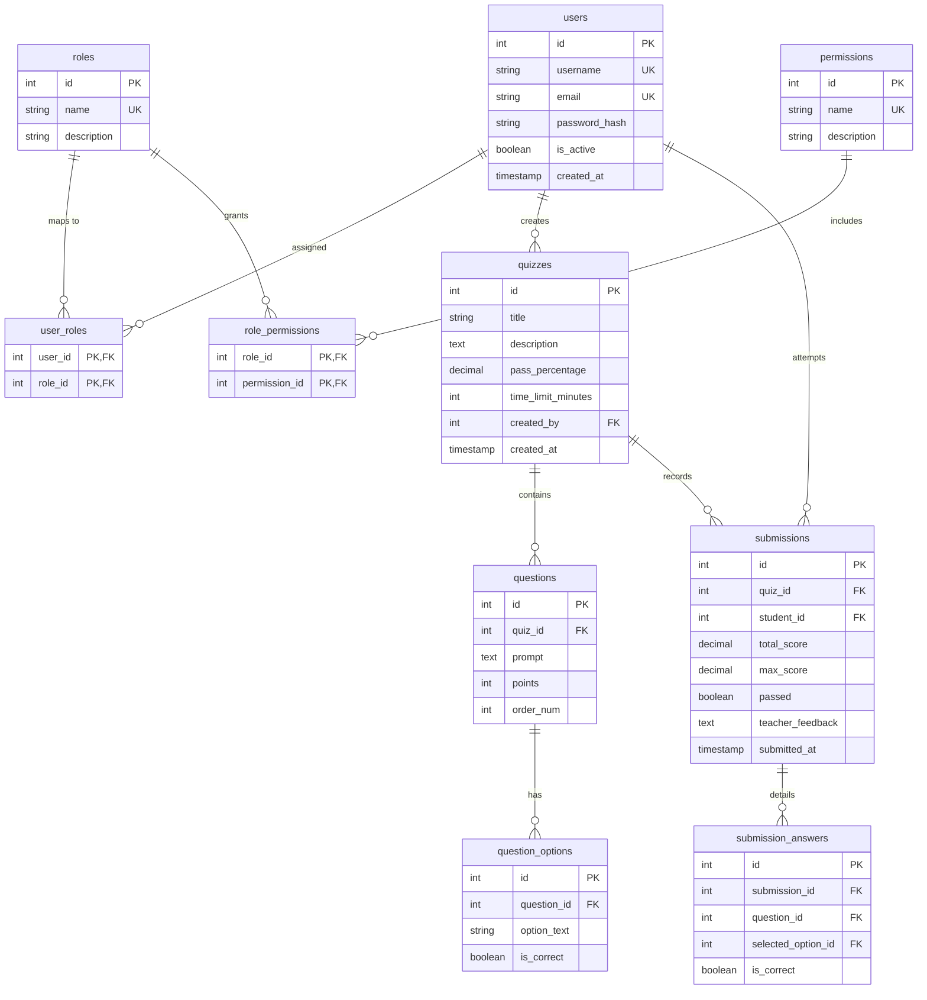

# Quiz Engine: Object-Oriented Flask & MySQL Assessment Platform

A production-ready Web Quiz Assessment Engine built with Python (Flask) and MySQL, implementing a **Decoupled 5-Table Role-Based Access Control (RBAC)** architecture, explicit atomic database transaction integrity, and a **Google Forms-inspired user experience**.

---

## 1. System Architecture

The application strictly adheres to a **Decoupled Layered Architecture**:

```
Quiz_Engine/
│
├── app/
│   ├── models/                  # Domain Layer (Pure Python Dataclasses)
│   │   ├── user.py              # User entity with RBAC authorization methods
│   │   ├── quiz.py              # Quiz aggregate root with scoring calculations
│   │   ├── question.py          # Question & QuestionOption with structural validation
│   │   ├── submission.py        # Submission & SubmissionAnswer with grading models
│   │   └── role.py              # Role & Permission value objects
│   │
│   ├── repositories/            # Data Access Layer (Parameterized Raw SQL & Transactions)
│   │   ├── db_connection.py     # MySQLConnectionPool singleton
│   │   ├── user_repository.py   # Parameterized RBAC traversal queries & user management
│   │   ├── quiz_repository.py   # Transactional CRUD & response analytics
│   │   └── submission_repository.py # Submission persistence & scoring adjustments
│   │
│   ├── services/                # Business Logic Layer (Orchestration & Rules)
│   │   ├── auth_service.py      # Authentication, password hashing, student registration
│   │   ├── quiz_service.py      # Google Form payload parsing & ownership enforcement
│   │   └── grading_service.py   # Automated grading, score recalculation, teacher feedback
│   │
│   ├── routes/                  # Web & Security Layer (Thin Controllers & Guards)
│   │   ├── security.py          # @login_required and @require_permission decorators
│   │   ├── web_bp.py            # User-facing routes (Admin, Teacher, Student)
│   │   ├── auth_bp.py           # API authentication endpoints
│   │   └── quiz_bp.py           # API assessment endpoints
│   │
│   └── templates/               # UI Layer (Google Forms Aesthetic)
│       ├── base.html            # Core layout with purple banner & RBAC navigation
│       ├── auth/                # Sign In & Student Sign Up cards
│       ├── admin/               # Admin command center & user role management
│       ├── teacher/             # Teacher hub, Google Form quiz builder, responses tab
│       └── student/             # Quiz catalog, Google Form taking view, result report
│
├── database/                    # Database DDL & Seeds
│   ├── schema.sql               # Pure 5-Table RBAC standard & assessment tables
│   ├── seed.sql                 # Roles, permissions, and role-permission mappings
│   └── init_db.py               # Automated schema migration & seed execution
│
├── tests/                       # Automated Test Suite (30 Unit & E2E Tests)
│   ├── test_quiz_engine.py      # Domain rules & automated evaluation tests
│   ├── test_rbac_and_features.py# RBAC authorization, Admin bypass, atomic transactions
│   ├── test_student_registration.py # Student self-registration & validation
│   └── test_live_e2e.py         # Live MySQL hydration, navigation, and grading flows
│
├── config.py                    # Environment configuration
├── requirements.txt             # Python dependencies
└── run.py                       # Application entrypoint
```

---

## 2. 5-Table RBAC Relational Schema

Authorization is strictly resolved through normalized many-to-many bridge tables. There is **no static `role_id` column** on the `users` table:



### Granular Permissions Matrix

| Permission | Description | Admin | Teacher | Student |
| :--- | :--- | :---: | :---: | :---: |
| `user:manage` | Create users, assign roles, toggle status, delete accounts | **Yes** (Bypass) | No | No |
| `quiz:create` | Create new quizzes, questions, and options via visual builder | **Yes** (Bypass) | **Yes** | No |
| `quiz:edit` | Update quizzes, questions, point values, and passing grade | **Yes** (Bypass) | **Yes** (Own) | No |
| `quiz:delete` | Remove quizzes and cascaded submission records | **Yes** (Bypass) | **Yes** (Own) | No |
| `quiz:score` | Adjust student scores and write personalized feedback | **Yes** (Bypass) | **Yes** | No |
| `quiz:view` | Inspect published quiz catalog and attempt questions | **Yes** (Bypass) | **Yes** | **Yes** |
| `quiz:submit` | Submit answers for automated evaluation | **Yes** (Bypass) | No | **Yes** |
| `report:view_all`| Inspect class-wide responses, analytics, and student answers | **Yes** (Bypass) | **Yes** | No |
| `report:view_own`| Review personal attempt history and score reports | **Yes** (Bypass) | **Yes** | **Yes** |

---

## 3. Key Features

### Google Forms Look & Feel
- **Visual Palette**: Signature Google Forms purple theme (`#673ab7`) with soft purple container backgrounds (`#f0ebf8`), rounded card containers, and active card focus accents.
- **Dynamic Quiz Builder (`/teacher/quizzes/new`)**: Interactive card-based question builder where teachers can add questions, specify points (`1 pt`, `2 pts`), configure a **Timed Assessment limit (`time_limit_minutes`)**, add options, and click a radio button directly on an option to define the **Answer Key (Correct Answer)**.
- **Form Taking View (`/quizzes/<id>`)**: Authentic Google Form questionnaire featuring points badges, custom radio buttons, active selection highlights, floating submit actions, and an **automatic countdown timer with auto-submit upon expiration**.
- **Responses & Analytics Tab (`/teacher/quizzes/<id>/responses`)**: Summary dashboard with real-time response count, average score, passing rate, individual submission review, and a one-click **CSV Data Export** (`/teacher/quizzes/<id>/export-csv`).
- **Manual Scoring & Qualitative Feedback (`/teacher/submissions/<id>/grade`)**: Teachers can adjust scores and leave student-visible feedback.
- **Student Self-Registration (`/register`)**: Open sign-up allowing students to create an account, which is automatically assigned the `Student` role in `user_roles` and authenticated into session.
- **Quick Demo Role Switcher (`/login`)**: Instant 1-click buttons to sign in as **Admin**, **Teacher**, or **Student** for defense demonstrations.

---

## 4. Setup & Installation

### Prerequisites
- Python 3.10+ (tested with Python 3.14)
- MySQL Server 8.0+ running on port `3306`

### 1. Environment Configuration
Edit or confirm `config.py`:
```python
import os

class Config:
    SECRET_KEY = os.getenv("SECRET_KEY", "academic-rnd-secret-key-2026")
    MYSQL_HOST = os.getenv("MYSQL_HOST", "127.0.0.1")
    MYSQL_USER = os.getenv("MYSQL_USER", "root")
    MYSQL_PASSWORD = os.getenv("MYSQL_PASSWORD", "")
    MYSQL_DATABASE = os.getenv("MYSQL_DATABASE", "quiz_engine_db")
    MYSQL_PORT = int(os.getenv("MYSQL_PORT", 3306))
```

### 2. Initialize Database & Seed RBAC Data
Run the database initialization script:
```powershell
.venv\Scripts\python.exe database\init_db.py
```
This automatically:
- Creates the `quiz_engine_db` database if not present.
- Enforces the 5-table relational RBAC schema and assessment tables.
- Seeds verified `Admin`, `Teacher`, and `Student` roles and permissions.
- Seeds demo users with hashed credentials (`Password@123`).
- Seeds a working assessment with questions and options.

### 3. Launch the Application
```powershell
.venv\Scripts\python.exe run.py
```
Open your browser at:
`http://127.0.0.1:5000`

---

## 5. Demo Credentials for Evaluation

All accounts share the default password: **`Password@123`**

| Persona | Username | Role | Dashboard URL | Capabilities |
| :--- | :--- | :--- | :--- | :--- |
| **Admin** | `admin` | Admin | `/admin/dashboard` | Manage all users, change roles via dropdown, toggle active status, manage all quizzes. |
| **Teacher** | `teacher_jane` | Teacher | `/teacher/dashboard` | Build quizzes, edit questions, inspect class responses, export CSV, adjust grades with feedback. |
| **Instructor** | `instructor_socheat` | Teacher | `/teacher/dashboard` | Secondary teacher account. |
| **Student** | `student_john` | Student | `/quizzes` | Browse quizzes, submit assessments with live timer, view instant score reports. |
| **New Student** | *(Self-register)* | Student | `/register` | Sign up independently, auto-login, and take quizzes. |

---

## 6. Automated Testing & Verification

The test suite includes 36 automated tests covering domain logic, 5-table RBAC authorization, security decorators, atomic transactions, timer parsing, CSV export, user management row indexing, deterministic ordering, student self-registration, and live MySQL integration:

```powershell
.venv\Scripts\python.exe -m unittest discover -s tests
```

Output:
```
....................................
----------------------------------------------------------------------
Ran 36 tests in 0.974s

OK
```

### Test Suite Structure:
- `tests/test_quiz_engine.py`: Domain validation rules, max score calculations, automated evaluation.
- `tests/test_rbac_and_features.py`: Granular permission checks, Admin wildcard bypass, Google Form payload parser, assessment timer handling, CSV export endpoint, `@require_permission` 403 enforcement, atomic transaction rollback.
- `tests/test_student_registration.py`: Student self-registration validation, password confirmation mismatch handling, duplicate username/email detection, session auto-login.
- `tests/test_live_e2e.py`: Live MySQL 5-table RBAC hydration, role-based page navigation, and quiz submission/grading workflows.
